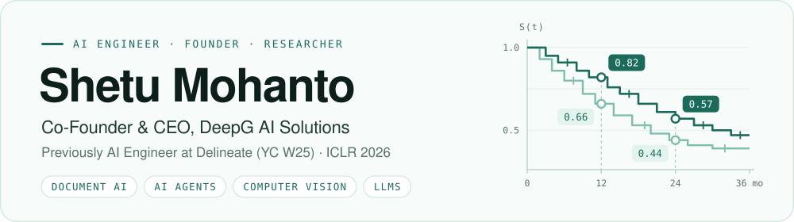

<picture>
  <source media="(prefers-color-scheme: dark)" srcset="assets/banner-dark.svg">
  
</picture>

  
  
  
  

## Hi, I'm Shetu

I build AI that does real work inside businesses. I'm the co-founder and CEO of **[DeepG AI Solutions](https://deepg.dev)** in Dhaka, where we build AI-driven custom software for B2B clients. DeepG is part of NVIDIA Inception and an OpenAI Select Partner.

Before DeepG I spent two and a half years at **[Delineate](https://delineate.pro) (YC W25)**, building AI that reads published papers, FDA and EMA reviews and clinical trial reports, and turns them into the evidence pharma teams use for go / no-go, dose-selection and trial-design decisions. Four of the top ten pharma companies use it, Sanofi among them.

- 🏢 **Now:** Co-Founder & CEO at DeepG ([deepg.dev](https://deepg.dev) · [deepg.com.bd](https://deepg.com.bd))
- 📄 **Latest paper:** [FlowNIB](https://openreview.net/forum?id=fF6n8gDCZH), on how information flows through bidirectional and unidirectional language models (ICLR 2026)
- 🧪 **Latest experiment:** [Finding vs. fixing for small Gemma 4 coding agents](https://github.com/shetumohanto7/gemma-4-developer-agent-paper), for the Kaggle Gemma 4 Developer Agent paper track
- 🎓 **Studied:** B.Sc. in Electrical & Electronic Engineering at KUET, CGPA 3.81 / 4.00, Dean's List three years running
- 📍 **Based in:** Dhaka, Bangladesh

## What I work on

<table>
  <tr>
    <td width="50%" valign="top">
      <h4>📑 Document AI</h4>
      Pull data tables out of papers, regulatory reviews and trial reports: baseline characteristics, adverse events, full dosing regimens. Every value links back to its source page, and an AI reviewer re-checks it before a human signs off.
    </td>
    <td width="50%" valign="top">
      <h4>📈 Charts back to numbers</h4>
      Vision models that read survival curves, dose-response plots and tumour-response waterfalls in published papers and turn them back into numbers, error bars included.
    </td>
  </tr>
  <tr>
    <td width="50%" valign="top">
      <h4>🤖 AI agents</h4>
      Multi-agent systems built with LangGraph, MCP and A2A, traced in Langfuse and served behind FastAPI, from prototype to production for B2B clients.
    </td>
    <td width="50%" valign="top">
      <h4>🎙️ Real-time voice</h4>
      Conversational agents on the OpenAI Realtime API, Deepgram and ElevenLabs over WebRTC.
    </td>
  </tr>
</table>

## Experience

| When | Role |
| :--- | :--- |
| **2026&nbsp;–&#8288;&nbsp;now** | **Co-Founder & CEO**, DeepG AI Solutions · Dhaka AI-driven custom software for B2B clients. |
| **2024&nbsp;–&#8288;&nbsp;2026** | **AI Engineer** (intern → junior → mid), Delineate (YC W25) · Cambridge, MA, remote Document-to-table extraction for pharma research, an AI reviewer that learns from human reviewers to raise fewer false alarms, and chart digitisation for survival, dose-response and waterfall plots. |
| **2024** | **AI Engineer**, BdThemes · remote Built a code-generation dataset and fine-tuned a 7B-parameter LLM on it. |
| **2023&nbsp;–&#8288;&nbsp;2024** | **Lecturer, Dept. of EEE**, Green University of Bangladesh and ULAB Syllabus committee, course coordinator, Deep Learning Research Cell. |
| **2021&nbsp;–&#8288;&nbsp;2022** | **Undergraduate Research Assistant**, Boise State University · remote Contributed to the book *Machine Learning Crash Course for Engineers*. |

## Publications

| Venue | Paper |
| :--- | :--- |
|  | **[FlowNIB: An Information Bottleneck Analysis of Bidirectional vs. Unidirectional Language Models](https://openreview.net/forum?id=fF6n8gDCZH)** |
|  | **[PEFT A2Z: Parameter-Efficient Fine-Tuning Survey for Large Language and Vision Models](https://arxiv.org/abs/2504.14117)** |
|  | **[A Multi-Scale Hyper Representation Network for Semantic Segmentation of Pulmonary Circulation Vessels in Pathology Assessment](https://ieeexplore.ieee.org/abstract/document/10991089)** |
|  | **[Fetal Head Segmentation and Head Circumference Measurement Using Residual U-Net](https://ieeexplore.ieee.org/abstract/document/10839692)** |

## Toolbox

| Area | Tools |
| :--- | :--- |
| **AI agents** |           |
| **Generative AI & vision** |          |
| **Real-time voice** |     |
| **Backend & data** |        |
| **Cloud & DevOps** |      |

## Teaching & community

- 🎤 **Trainer**, *AI for Finance*, corporate training for bKash with NetCom Learning Bangladesh (2026)
- ⚖️ **Judge**, National Datathon at CUET CSE FEST 2025
- 🧑‍🏫 **Instructor**, *Hands-On Machine Learning with Python* (NeuralFrameAI), East West University Robotics Club (2024)
- 🚀 **Control team**, KUET Mars Rover Team Durbar: designed the rover's camera, communication and navigation system. ARC and CIRC finalist, 10th at IRDC 2020
- 🤝 **Vice Chairperson**, IEEE Student Branch KUET · **Vice President**, EEE Association KUET

Working on documents, agents or vision models? Say hello on <a href="https://linkedin.com/in/shetumohanto">LinkedIn</a>.

